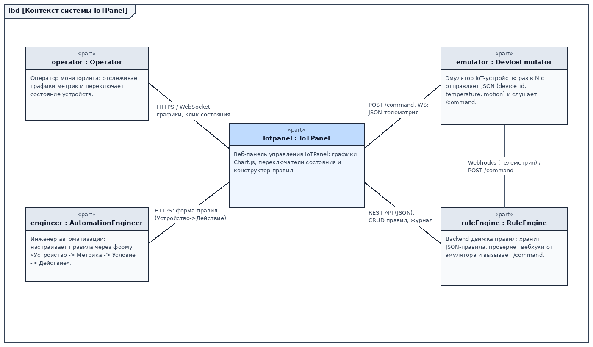
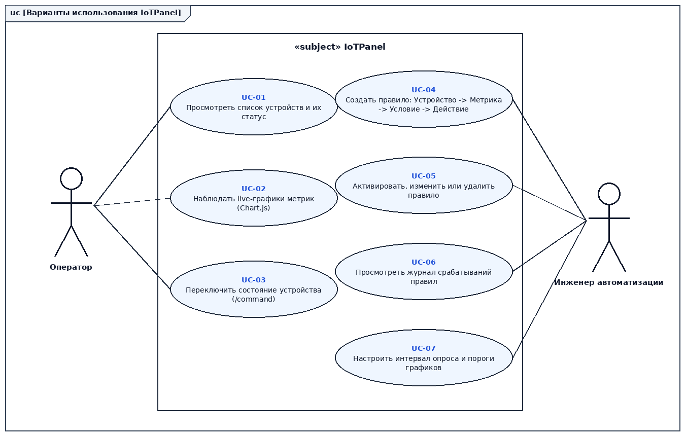
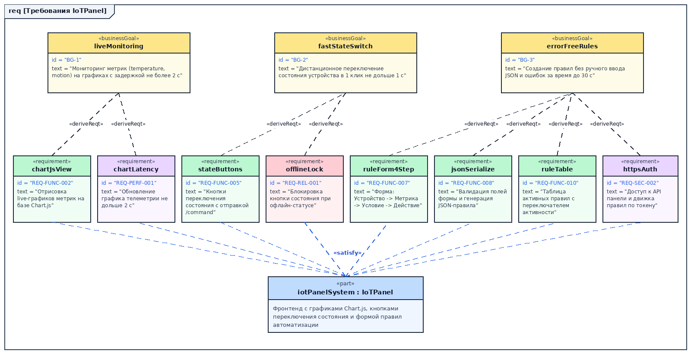
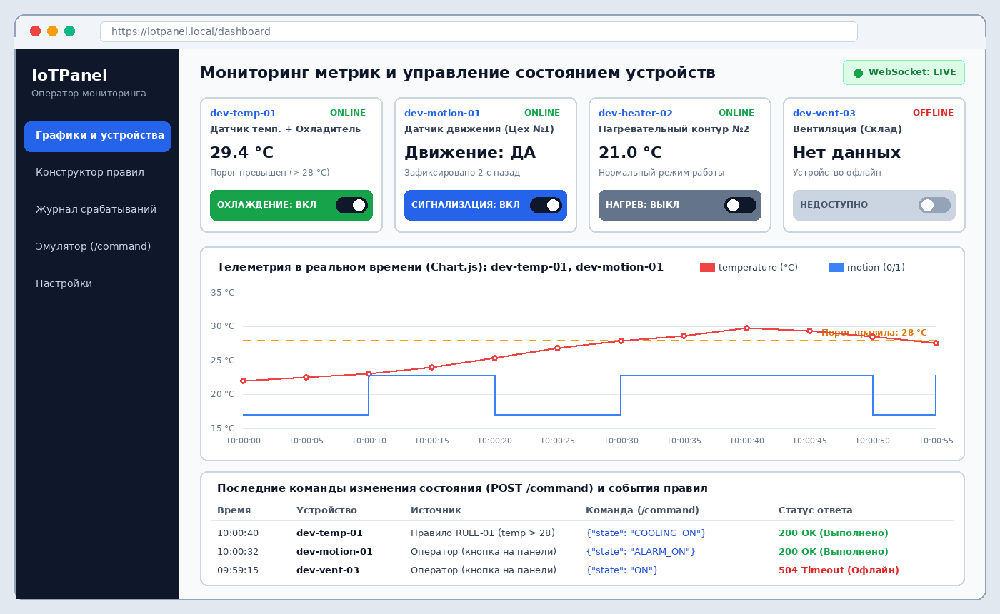
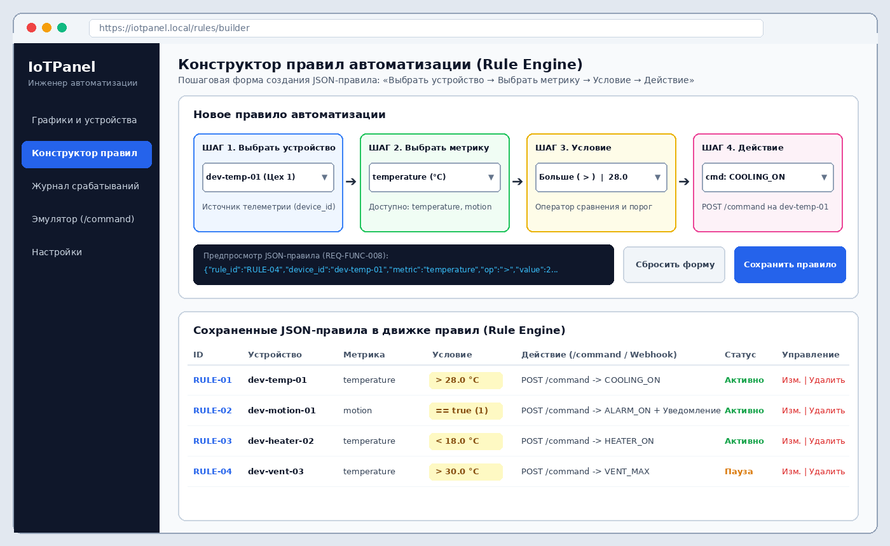

# Спецификация требований к программному обеспечению (SRS)
## Проект: IoTPanel — Панель управления IoT-устройствами и правилами автоматизации

**Версия:** 0.1  
**Статус:** На ревью  
**Стандарт:** ISO/IEC/IEEE 29148:2018  

---

## 1. Введение

### 1.1 Назначение
Настоящий документ представляет собой спецификацию требований к программному обеспечению (SRS) для веб-приложения **IoTPanel** (Вариант 10). Документ предназначен для команды разработки, тестировщиков и заказчика.

### 1.2 Область применения и бизнес-цели
Система **IoTPanel** представляет собой фронтенд-панель управления с графиками телеметрии на базе `Chart.js`, кнопками переключения состояния устройств и пошаговой формой конструктора правил автоматизации: «Выбрать устройство → Выбрать метрику → Условие → Действие».

**Бизнес-цели (Business Goals):**
* **BG-1:** Обеспечить наглядный мониторинг метрик устройств (`temperature`, `motion`) в реальном времени с задержкой отображения на графиках не более 2 с.
* **BG-2:** Сократить время дистанционного переключения состояния устройства оператором до 1 с с гарантированной индикацией результата.
* **BG-3:** Исключить синтаксические ошибки при создании JSON-правил автоматизации и сократить время настройки одного правила до 30 с за счёт визуальной формы «Выбрать устройство → Выбрать метрику → Условие → Действие».

### 1.3 Глоссарий
* **IoTPanel** — разрабатываемая веб-панель управления.
* **Эмулятор устройств (Device Emulator)** — внешний сервис, генерирующий JSON с полями `device_id`, `temperature`, `motion` и принимающий команды на `/command`.
* **Движок правил (Rule Engine)** — внешний Backend-сервис, проверяющий входящие вебхуки против сохранённых JSON-правил.

---

## 2. Обзор продукта

### 2.1 Перспектива продукта и контекст
Система взаимодействует с двумя внешними сервисами: Эмулятором устройств и Backend-сервисом Движка правил.

Модель контекста: [`models/iotpanel-context.sysml`](models/iotpanel-context.sysml).

### 2.2 Функции продукта (Варианты использования)
Основные варианты использования (`UC-01` – `UC-07`) разделены между Оператором мониторинга и Инженером автоматизации:

Модель вариантов использования: [`models/iotpanel-usecases.sysml`](models/iotpanel-usecases.sysml).

### 2.3 Пользователи
1. **Оператор мониторинга** — отслеживает графики метрик в реальном времени и вручную переключает состояние устройств кнопками на панели.
2. **Инженер автоматизации** — создаёт, редактирует и отключает правила автоматизации через визуальную форму.

### 2.4 Ограничения (Constraints)
* **CON-1:** Клиентская часть работает в современных веб-браузерах (Chrome, Firefox, Edge) без установки дополнительного ПО.
* **CON-2:** Для построения графиков обязательно используется библиотека `Chart.js`.
* **CON-3:** Форма создания правил строго следует шаблону из 4 шагов: «Выбрать устройство → Выбрать метрику → Условие → Действие».
* **CON-4:** Обмен командами с устройствами осуществляется через HTTP-эндпоинт `/command` в формате JSON.
* **CON-5:** Правила автоматизации сериализуются и передаются на сервер в формате JSON.
* **CON-6:** Язык интерфейса — русский.

### 2.5 Допущения (Assumptions)
* **AS-1:** Эмулятор устройств и Движок правил доступны в локальной сети или через Docker-сеть.
* **AS-2:** Каждое устройство имеет уникальный идентификатор `device_id`.
* **AS-3:** Частота отправки телеметрии эмулятором составляет от 1 до 10 секунд.
* **AS-4:** Сеть между браузером оператора и сервером обеспечивает пропускную способность не менее 1 Мбит/с.
* **AS-5:** Операторы и инженеры прошли базовый инструктаж по работе с веб-браузером.

---

## 3. Требования

Диаграмма трассируемости требований от бизнес-целей:

Модель требований: [`models/iotpanel-requirements.sysml`](models/iotpanel-requirements.sysml).

### 3.1 Требования к внешним интерфейсам (REQ-INT)

#### Интерфейс пользователя (GUI)
Прототипы экранов панели мониторинга и конструктора правил:

Модель графического интерфейса: [`models/iotpanel-ui.sysml`](models/iotpanel-ui.sysml).

* **REQ-INT-001 (Главный дашборд):** Панель должна отображать карточки устройств, блок графика `Chart.js` и журнал последних команд на одном экране с разрешением от 1280×800. *(Verification: Inspection)*
* **REQ-INT-002 (Экран конструктора правил):** Панель должна содержать экран с 4-шаговой формой создания правила, блоком предпросмотра JSON и таблицей активных правил. *(Verification: Inspection)*
* **REQ-INT-003 (Получение телеметрии):** Клиент должен принимать пакеты телеметрии в формате JSON (`{"device_id": string, "temperature": number, "motion": boolean}`) по WebSocket или HTTP-опросу. *(Verification: Test)*
* **REQ-INT-004 (Отправка команды переключения):** При нажатии кнопки состояния клиент должен отправлять POST-запрос на эндпоинт `/command` с JSON-телом команды. *(Verification: Test)*
* **REQ-INT-005 (API сохранения правила):** Клиент должен отправлять созданное JSON-правило методом POST на эндпоинт `/api/rules` движка правил. *(Verification: Test)*
* **REQ-INT-006 (API списка правил):** Клиент должен запрашивать список существующих правил методом GET `/api/rules`. *(Verification: Test)*
* **REQ-INT-007 (API удаления/обновления правила):** Клиент должен поддерживать изменение статуса и удаление правил через PATCH/DELETE `/api/rules/:id`. *(Verification: Test)*

### 3.2 Функциональные требования (REQ-FUNC)

* **REQ-FUNC-001 (Список устройств):** Система должна отображать карточки всех подключённых устройств с их `device_id`, текущими значениями метрик и статусом связи (`ONLINE` / `OFFLINE`). *(Rationale: BG-1, Verification: Test)*
* **REQ-FUNC-002 (Графики Chart.js):** Система должна отображать линейный график температуры (`temperature`) и ступенчатый график датчика движения (`motion`) с использованием библиотеки `Chart.js`. *(Rationale: BG-1, Verification: Demonstration)*
* **REQ-FUNC-003 (Live-обновление графиков):** При поступлении нового JSON-пакета телеметрии график `Chart.js` должен автоматически добавлять новую точку без перезагрузки страницы. *(Rationale: BG-1, Verification: Test)*
* **REQ-FUNC-004 (Линия порога на графике):** На графике температуры должна отображаться пунктирная линия порогового значения из активного правила. *(Rationale: BG-1, Verification: Inspection)*
* **REQ-FUNC-005 (Кнопки переключения состояния):** Каждая карточка управляемого устройства должна содержать кнопку-тумблер переключения состояния (`ВКЛ / ВЫКЛ`), инициирующую запрос на `/command`. *(Rationale: BG-2, Verification: Test)*
* **REQ-FUNC-006 (Индикация результата команды):** После получения ответа `200 OK` от `/command` кнопка должна менять цвет и текст состояния, а запись о команде — добавляться в нижнюю таблицу журнала. *(Rationale: BG-2, Verification: Test)*
* **REQ-FUNC-007 (Конструктор правил автоматизации):** Панель управления должна предоставлять форму создания правила из четырёх последовательных полей: «Выбрать устройство», «Выбрать метрику» (`temperature`, `motion`), «Условие» (`>`, `<`, `==`, `!=` и порог) и «Действие» (целевая команда `/command`). *(Rationale: BG-3, Verification: Test)*
* **REQ-FUNC-008 (Валидация и генерация JSON-правила):** Система должна автоматически проверять заполнение всех 4 шагов формы и формировать валидный JSON-объект правила с предпросмотром на экране. *(Rationale: BG-3, Verification: Test)*
* **REQ-FUNC-009 (Сброс формы):** Кнопка «Сбросить форму» должна очищать выбранные значения всех 4 шагов к состоянию по умолчанию. *(Rationale: BG-3, Verification: Test)*
* **REQ-FUNC-010 (Таблица сохранённых правил):** Панель должна отображать таблицу всех JSON-правил, загруженных из Rule Engine, с указанием ID, устройства, метрики, условия, действия и статуса. *(Rationale: BG-3, Verification: Demonstration)*
* **REQ-FUNC-011 (Переключение активности правила):** Инженер должен иметь возможность поставить правило на паузу или активировать его из таблицы правил. *(Rationale: BG-3, Verification: Test)*
* **REQ-FUNC-012 (Удаление правила):** Инженер должен иметь возможность удалить правило из движка правил нажатием кнопки «Удалить». *(Rationale: BG-3, Verification: Test)*
* **REQ-FUNC-013 (Журнал команд и срабатываний):** Панель должна выводить последние события отправки `/command` с указанием времени, источника (оператор или правило) и HTTP-статуса ответа. *(Rationale: BG-1, BG-2, Verification: Test)*

### 3.3 Требования к производительности (REQ-PERF)
* **REQ-PERF-001 (Задержка отображения телеметрии):** Время от получения JSON-пакета телеметрии до отрисовки точки на графике `Chart.js` не должно превышать 2 с (в среднем не более 300 мс). *(Rationale: BG-1, Verification: Test)*
* **REQ-PERF-002 (Плавность рендеринга графика):** График должен хранить скользящее окно из последних 60 точек и обеспечивать частоту кадров не ниже 30 FPS. *(Verification: Test)*
* **REQ-PERF-003 (Время отклика кнопки состояния):** Время выполнения запроса переключения состояния `/command` и обновления UI не должно превышать 1 с при штатной работе сети. *(Rationale: BG-2, Verification: Test)*

### 3.4 Требования к безопасности (REQ-SEC)
* **REQ-SEC-001:** Все вводимые в форме пороговые значения должны проходить санитизацию и проверку типа (число/булево) перед формированием JSON. *(Verification: Test)*
* **REQ-SEC-002:** Доступ к API изменения состояния (`/command`) и сохранения правил (`/api/rules`) должен осуществляться по протоколу HTTPS с передачей токена сессии. *(Verification: Test)*
* **REQ-SEC-003:** Разграничение ролей: Оператор имеет доступ к переключению состояния, Инженер автоматизации — к созданию и удалению правил. *(Verification: Test)*
* **REQ-SEC-004:** Защита от XSS при рендеринге идентификаторов устройств и названий правил в таблицах. *(Verification: Inspection)*
* **REQ-SEC-005:** Журналирование всех ручных переключений состояния с фиксацией времени и результата. *(Verification: Test)*

### 3.5 Надёжность, доступность и наблюдаемость (REQ-REL, AVAIL, OBS)
* **REQ-REL-001 (Блокировка при офлайн-статусе):** Если устройство находится в статусе `OFFLINE`, кнопка переключения его состояния должна автоматически блокироваться (`НЕДОСТУПНО`). *(Verification: Test)*
* **REQ-REL-002 (Обработка таймаута команды):** Если эмулятор не отвечает на `/command` более 3 с, тумблер возвращается в исходное состояние и выводится статус `504 Timeout`. *(Verification: Test)*
* **REQ-REL-003 (Автопереподключение WebSocket):** При обрыве связи с сервером телеметрии клиент должен автоматически пытаться переподключиться каждые 5 с. *(Verification: Test)*
* **REQ-AVAIL-001:** Доступность веб-интерфейса панели управления во время рабочей смены должна составлять не менее 99,5%. *(Verification: Analysis)*
* **REQ-OBS-001:** Индикатор состояния соединения (`WebSocket: LIVE` / `DISCONNECTED`) должен постоянно отображаться в шапке панели. *(Verification: Inspection)*

### 3.6 ИИ / Машинное обучение
Неприменимо (система использует детерминированные пороговые правила без компонентов ИИ/МО).

### 3.7 Соответствие стандартам (REQ-COMP)
* **REQ-COMP-001:** Документация требований оформлена в соответствии с ISO/IEC/IEEE 29148:2018. *(Verification: Inspection)*
* **REQ-COMP-002:** Обмен данными соответствует стандарту RFC 8259 (формат JSON). *(Verification: Inspection)*
* **REQ-COMP-003:** Графические модели системы выполнены в нотации стандарта OMG SysML v2. *(Verification: Inspection)*

### 3.8 Проектирование и реализация (REQ-INST, BUILD, MAINT, POC)
* **REQ-INST-001:** Развёртывание приложения и сопутствующих сервисов должно выполняться одной командой `docker compose up -d`. *(Verification: Test)*
* **REQ-INST-002:** Конфигурация адресов API эмулятора и движка правил должна задаваться через переменные окружения (`.env`). *(Verification: Inspection)*
* **REQ-BUILD-001:** Сборка фронтенда должна выполняться без ошибок компиляции TypeScript (`npm run build`). *(Verification: Test)*
* **REQ-MAINT-001:** Модули графика, карточек устройств и конструктора правил должны быть реализованы как независимые UI-компоненты. *(Verification: Inspection)*
* **REQ-POC-001:** Работоспособность связки «Форма → JSON-правило → График Chart.js → Кнопка `/command`» должна быть подтверждена демонстрационным прототипом. *(Verification: Demonstration)*

---

## 4. Верификация

Все 41 требование верифицируются методами тестирования (`Test`), демонстрации (`Demonstration`), инспекции (`Inspection`) и анализа (`Analysis`) согласно критериям приёмки, указанным в разделе 3.